# Gazewell

A macOS menu bar app that reminds you to rest your eyes, fix your posture and blink, timed around natural pauses. An independent open-source project, not affiliated with any other break-reminder app.

<p align="center">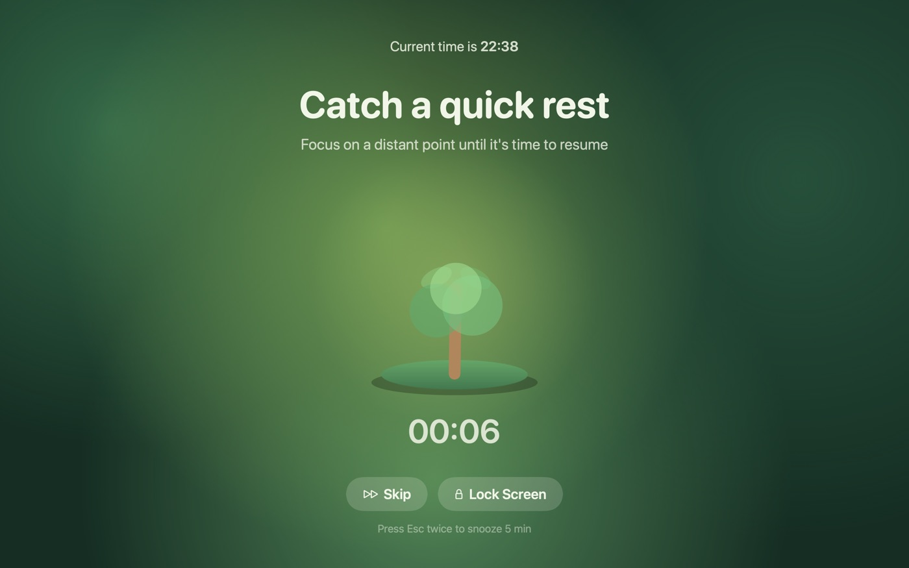</p>

## Screenshots

### Seven themes, each with its own break scene
Every theme restyles the whole app, and the break screen plays a scene that advances with the break: a tree grows, stones stack, water rises, dandelion seeds blow away, a moon crosses the sky, a ring breathes.

<table>
  <tr>
    <td align="center">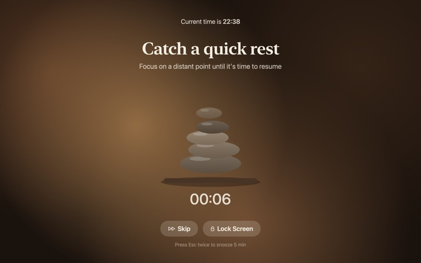<br>Earth</td>
    <td align="center">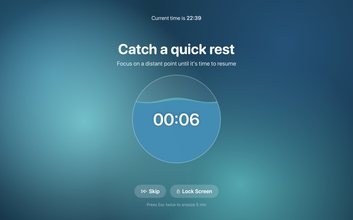<br>Ocean</td>
    <td align="center">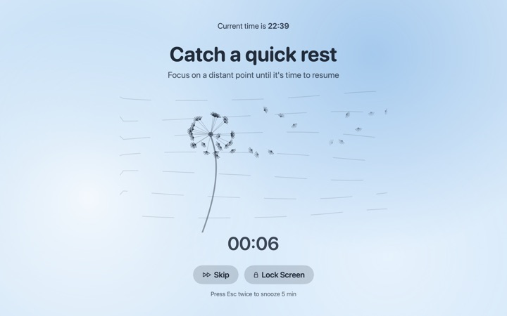<br>Air</td>
  </tr>
  <tr>
    <td align="center">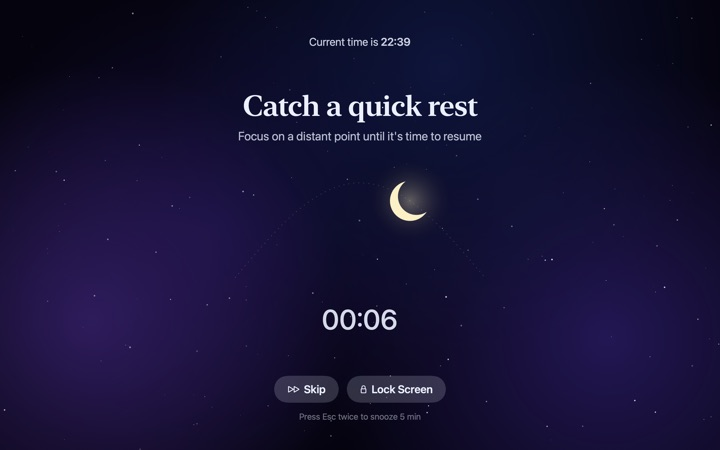<br>Night sky</td>
    <td align="center">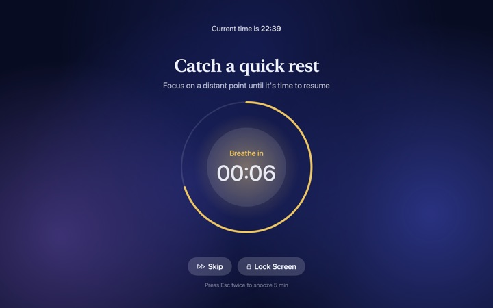<br>Medito</td>
    <td align="center">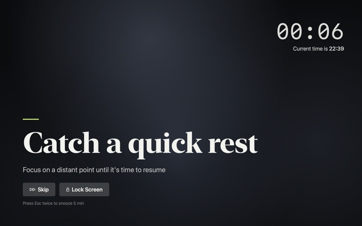<br>Mono focus</td>
  </tr>
</table>

Forest is shown at the top of this page.

### Settings, menu bar and heads-up
<table>
  <tr>
    <td valign="top">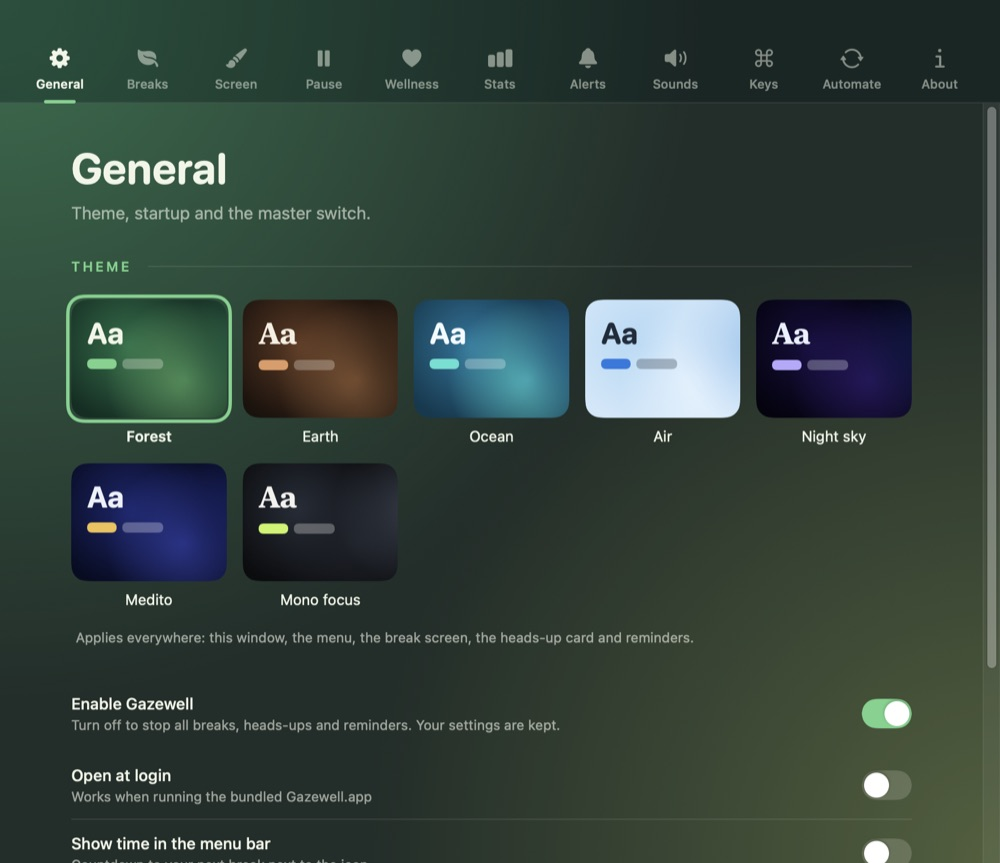</td>
    <td valign="top">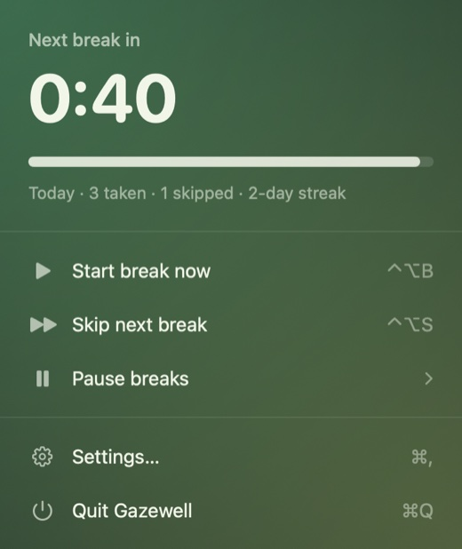</td>
  </tr>
</table>

<p align="center">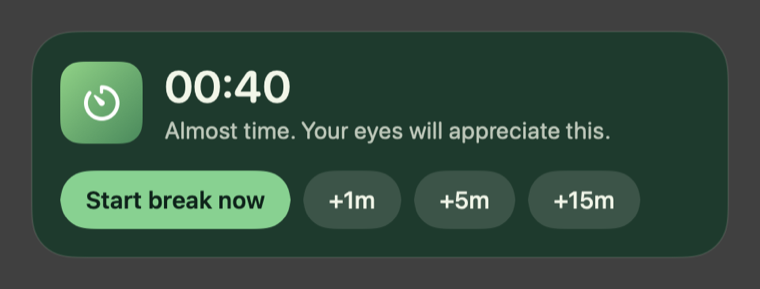</p>

### Full-screen wellness reminders
Gentle animations in your theme, never a full break: rain for water, rising chevrons for posture, slow eyelids for blinking, silk ribbons for stretching.

<table>
  <tr>
    <td align="center">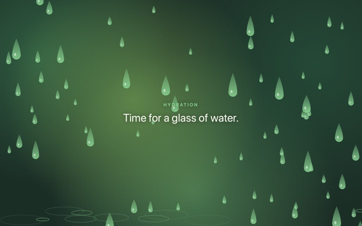<br>Hydration</td>
    <td align="center">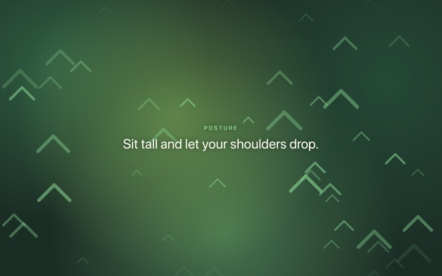<br>Posture</td>
    <td align="center">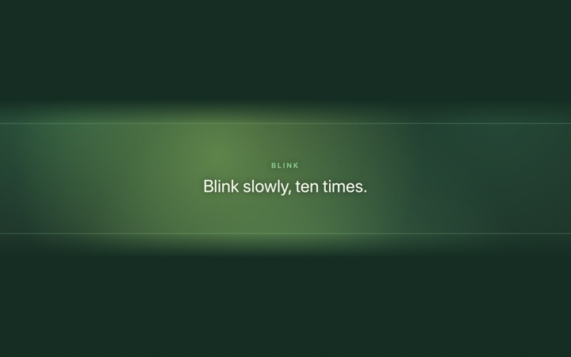<br>Blink</td>
    <td align="center">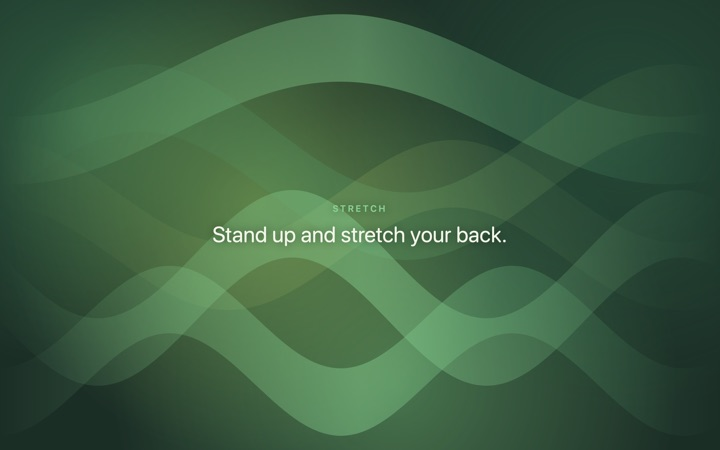<br>Stretch</td>
  </tr>
</table>

<sub>Images are rendered by the app itself (`Gazewell --snapshot <folder>`), so the real macOS background blur isn't visible in them.</sub>

## Features
- Eye breaks with a heads-up card (+1m / +5m / +15m), a cursor-following countdown and periodic long breaks
- Break enforcement (casual, balanced, hardcore), a daily snooze limit, a double-Esc action and optional auto-lock
- Smart pause: skips breaks during calls (microphone or camera in use), delays for screen recording, video and fullscreen apps; time away counts as a break
- Office hours and planned breaks (e.g. lunch)
- Full-screen wellness reminders (posture, blink, hydration, stretch) in your theme
- Seven themes (Forest, Earth, Ocean, Air, Night sky, Medito, Mono focus), per-role fonts, sounds, custom messages and backgrounds
- Stats and streaks, global shortcuts, Shortcuts/AppleScript hooks, launch at login

## Build
Requires macOS 13+ and the Swift toolchain (Command Line Tools are enough).

```sh
./bundle.sh && open Gazewell.app   # build and run
./dmg.sh                           # build Gazewell-<version>.dmg for installing
./test.sh                          # scheduler tests
```

Global shortcuts: ⌃⌥B start a break, ⌃⌥S skip next, ⌃⌥P turn breaks off/on.

The app is ad-hoc signed, not notarized: on first launch right-click → Open.

## Versioning
Gazewell follows [Semantic Versioning](https://semver.org/). The single source of truth is the `VERSION` file; `bundle.sh` stamps it into the app, so it shows in Settings → About.

- Note changes under `## [Unreleased]` in [CHANGELOG.md](CHANGELOG.md) as you work.
- Cut a release with `./release.sh patch|minor|major`. It bumps `VERSION`, dates the changelog section, commits and tags `vX.Y.Z`.
- Then `git push && git push --tags`.
